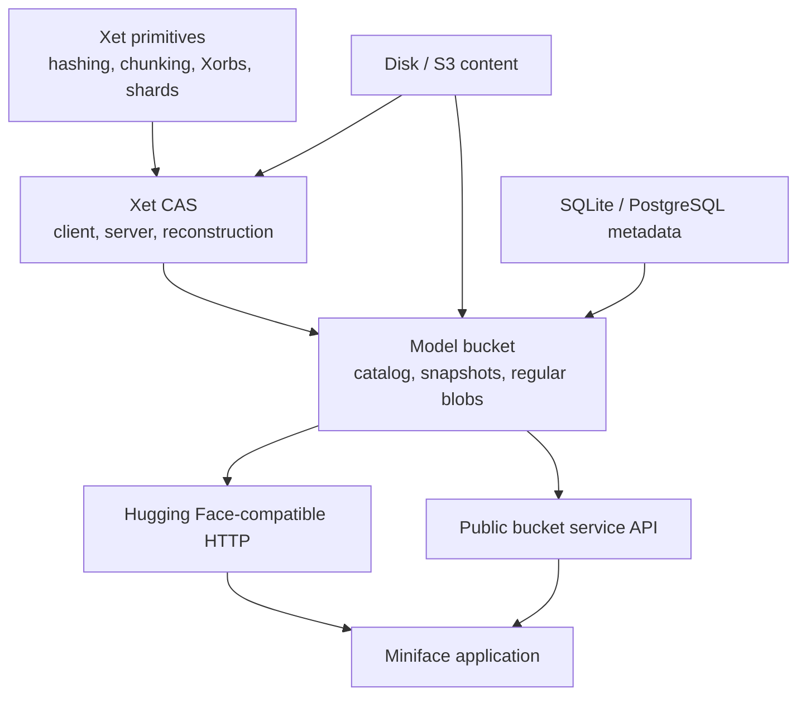

# xet-go implementation handoff

**Repository:** `xet-go`

**Audience:** implementation agents taking ownership of the Go protocol and model-bucket stack

**Primary consumer:** Miniface

**Status:** implementation charter and acceptance plan
**Last reviewed:** 2026-08-10

## 1. Assignment

Turn `xet-go` into a complete, embeddable Go implementation of:

1. the Xet content model and wire protocol;
2. a production-capable Xet CAS client and server;
3. the minimal Hugging Face-compatible model-bucket behavior needed by real `hf` clients and common model tooling; and
4. storage abstractions for local disk, S3-compatible object storage, SQLite, and PostgreSQL.

Miniface should be able to import `xet-go`, configure storage and authentication, mount its HTTP handlers, and use its typed service API. Miniface owns the application, UI, configuration experience, background-job presentation, and operator workflows. `xet-go` owns the technical correctness of model storage, repository metadata, protocol compatibility, and reconstruction.

This document is standalone. Do not assume another design document is available.

## 2. Read this before changing the tree

The current worktree contains substantial uncommitted implementation work. It is not a clean baseline and must not be reset, discarded, or overwritten.

At the time this handoff was written:

- repository HEAD was `056869934df1`;
- `go test ./...` passed;
- the worktree included new or modified CAS server, Xorb ingestion, shard registration, planner, and conformance code;
- reverse conformance using the official Rust client against the Go server had been added; and
- storage-prefix and optional-SHA protocol corrections were already present.

Before implementation:

```bash
cd /path/to/xet-go
git status --short
git diff --stat
go test ./...
```

Treat every existing modification as intentional until it has been reviewed. Make small commits organized by behavior. Do not fold unrelated current changes into a rewrite.

The repository/module-path discrepancy has been resolved with the owner: `github.com/jmwoliver/xet-go` is the canonical repository and Go module path. The deliberate one-time migration was completed before publishing stable module versions.

## 3. Product boundary

`xet-go` is one repository, but it must retain strong internal package boundaries.



The repository is an umbrella implementation, not a license to mix every concern together.

### `xet-go` owns

- Xet hashing, chunking, Xorb and shard formats;
- CAS upload, download, deduplication, reconstruction, and range planning;
- CAS HTTP routes and protocol error behavior;
- model namespaces, repositories, revisions, immutable snapshots, files, and refs;
- ordinary blob storage alongside Xet-backed files;
- the subset of Hugging Face HTTP behavior required for model-bucket clients;
- Hub-token and CAS-token verification primitives;
- storage interfaces and supported backend implementations;
- consistency checking, reachability, repair, and garbage-collection primitives;
- typed APIs Miniface can call without making internal HTTP requests; and
- conformance fixtures and differential tests.

### Miniface owns

- the executable and process lifecycle;
- user-facing configuration and secret entry;
- the web UI and operator experience;
- deciding which `xet-go` capabilities and policies to expose;
- job scheduling and UI-visible job progress;
- user and organization administration beyond the minimal authorization hooks;
- deployment packaging, health dashboards, logs, and metrics presentation; and
- optional conveniences such as model cards, search, tags, favorites, and usage history.

### Guardrail inside `xet-go`

The low-level Xet and CAS packages must remain usable independently. They must not import model-catalog, HTTP-compatibility, UI, or application packages. Dependencies point upward only.

The existing low-level client must continue to work when no model catalog, SQL database, or Hugging Face-compatible endpoint is configured.

## 4. Target package shape

Exact names may follow existing repository conventions, but dependency direction must remain equivalent to this layout:

```text
xet-go/
├── chunker/                 # content-defined chunking
├── xethash/                 # Xet/Merkle hash primitives
├── xorb/                    # Xorb encoding, decoding, validation
├── shard/                   # shard encoding, decoding, registration
├── xetcas/
│   ├── client.go            # CAS client
│   ├── planner.go           # upload/download planning
│   └── server/              # hosting-neutral CAS service + HTTP handler
├── bucket/                  # public embeddable model-bucket façade
├── model/                   # repository/snapshot/ref/file domain types
├── catalog/                 # metadata interfaces and transactions
│   ├── memory/
│   ├── sqlite/
│   └── postgres/
├── content/                 # ordinary blobs and shared object-store interfaces
│   ├── filesystem/
│   ├── s3/
│   └── cache/
├── hfcompat/                # Hugging Face-compatible routes and DTO translation
├── auth/                    # Hub and CAS token contracts
├── maintenance/             # audit, reachability, repair, GC
└── conformance/             # official Rust and real-client tests
```

Avoid one giant server package. Protocol routes should delegate to services; services should depend on narrow storage interfaces; backend packages should implement those interfaces.

Avoid exporting protocol DTOs as the primary application API. Miniface should consume stable domain types and streams, not JSON structs copied from a specific client response.

## 5. Current implementation baseline

An implementation agent must verify this list against the worktree rather than recreating it.

### Already implemented or substantially implemented

- content-defined chunking and Xet hashing;
- Xorb encoding/decoding, including compression and validation;
- shard encoding/decoding and lookup structures;
- CAS client upload and download paths;
- v1 and v2 reconstruction support;
- CAS batch reconstruction and chunk-hash routes;
- global deduplication planning;
- configurable Xorb and dedup storage prefixes using the official defaults;
- an optional SHA-256 field represented as optional rather than a zero-value sentinel;
- hosting-neutral CAS server interfaces;
- Xorb ingestion and canonicalization;
- shard registration that validates referenced Xorbs and terms;
- in-memory CAS stores and HTTP tests;
- official fixture and Rust differential harnesses;
- Go-client-to-official-Rust-server tests; and
- official-Rust-client-to-Go-server tests;
- namespace-scoped file, dedup, and SHA reachability over globally deduplicated
  physical Xorbs; and
- typed full/range reconstruction streaming through `Service.OpenFile`, sharing
  the wire planner and enforcing backpressure, cancellation, closure, lengths,
  chunk hashes, and optional whole-file SHA-256.

### Important current interfaces

The current CAS server separates blob and index concerns through interfaces similar to:

- `BlobStore` for Xorb and shard bytes;
- `IndexStore` for file, deduplication, and SHA associations;
- `Authorizer` for request authorization; and
- `RangeURLSigner` for object-store range downloads.

Preserve this separation unless a concrete correctness issue requires a change.

### Known areas requiring stabilization

The namespace-safe read model and typed reconstruction stream were completed
and revalidated in both official Rust interoperability directions on
2026-08-10. Remaining CAS stabilization work is:

- atomic publication order and failure recovery;
- durable persistence of global-dedup protection records;
- bounded memory use during Xorb and shard validation;
- safe handling of duplicate/non-unique file and dedup index rows;
- consistent protocol error taxonomy and HTTP mappings;
- malformed range and integer-overflow handling;
- exact behavior of legacy storage prefixes;
- iteration primitives needed by audit and garbage collection; and
- migration from in-memory semantics to transactional SQL semantics.

Do not build the model layer on ambiguous namespace or publication semantics.

## 6. Required model-bucket domain

### 6.1 Repository identity

The initial product scope is model repositories. Represent identity structurally:

```go
type RepoKey struct {
    Namespace string
    Name      string
    Type      RepoType
}
```

Initially `RepoTypeModel` is the only required type. Keep the type in the key so future dataset or space support does not require a schema rewrite, but do not implement those product surfaces now.

Canonicalization rules must be explicit and tested:

- namespace and repository name validation;
- case sensitivity;
- reserved path components;
- maximum lengths;
- URL escaping; and
- rejection of traversal and ambiguous Unicode forms.

### 6.2 Immutable snapshots and mutable refs

A repository consists of immutable, complete snapshots and mutable refs.

```go
type Snapshot struct {
    Repo       RepoKey
    CommitOID  string
    ParentOID  string
    CreatedAt  time.Time
    Author     Identity
    Message    string
    Files      []FileEntry
}
```

Use 40-character lowercase hexadecimal commit identifiers at the compatibility boundary. A snapshot is visible only after all referenced content and metadata have been durably published.

Required invariants:

- snapshots never change after publication;
- refs update atomically using compare-and-swap semantics;
- `main` exists after the first successful commit;
- a revision may resolve from a full commit identifier or a ref;
- a ref never points to an incomplete snapshot;
- a failed commit leaves the previous ref readable;
- file paths within one snapshot are unique and sorted canonically for hashing; and
- deletion is represented by omission from the new complete snapshot, even if the wire commit uses operations.

The catalog must provide a transaction or equivalent atomic operation for publishing a snapshot and advancing a ref.

### 6.3 File representations

Support two file kinds in a snapshot:

```go
type FileEntry struct {
    Path       string
    Size       int64
    SHA256     *[32]byte
    Kind       FileKind
    Blob       *BlobRef
    Xet        *XetFileRef
}
```

- `BlobRef`: ordinary file bytes in the content store.
- `XetFileRef`: file identity and metadata required for CAS reconstruction.

Small files, configuration, tokenizers, model cards, and clients that do not negotiate Xet must work as ordinary blobs. Large Xet-backed weights must reconstruct through the same typed file-open operation.

Do not make callers care which representation was used.

### 6.4 Required catalog interface

The exact Go spelling may differ, but the abstraction must cover:

```go
type Catalog interface {
    CreateRepository(ctx context.Context, repo RepoKey, opts CreateRepoOptions) error
    GetRepository(ctx context.Context, repo RepoKey) (Repository, error)
    ListRepositories(ctx context.Context, q RepositoryQuery) (RepositoryPage, error)

    ResolveRevision(ctx context.Context, repo RepoKey, revision string) (Snapshot, error)
    GetSnapshot(ctx context.Context, repo RepoKey, oid string) (Snapshot, error)
    ListSnapshots(ctx context.Context, repo RepoKey, q SnapshotQuery) (SnapshotPage, error)

    GetRef(ctx context.Context, repo RepoKey, name string) (Ref, error)
    CompareAndSwapRef(ctx context.Context, repo RepoKey, name, oldOID, newOID string) error
    PublishSnapshot(ctx context.Context, snapshot Snapshot, expectedRef RefExpectation) error

    GetFile(ctx context.Context, repo RepoKey, revision, path string) (FileEntry, error)
    ListFiles(ctx context.Context, repo RepoKey, revision, prefix string) ([]FileEntry, error)
}
```

Every lookup must carry a repository/storage namespace. Hash possession alone must not grant cross-namespace read access.

## 7. Public service API for Miniface

Provide one high-level façade that composes the catalog, content store, CAS, auth, and compatibility handlers.

Conceptually:

```go
type Service interface {
    HubHandler() http.Handler
    CASHandler() http.Handler

    CreateRepository(context.Context, RepoKey, CreateRepoOptions) (Repository, error)
    ListRepositories(context.Context, RepositoryQuery) (RepositoryPage, error)
    GetRepository(context.Context, RepoKey) (Repository, error)
    ResolveRevision(context.Context, RepoKey, string) (Snapshot, error)
    ListSnapshots(context.Context, RepoKey, SnapshotQuery) (SnapshotPage, error)
    ListFiles(context.Context, RepoKey, string, string) ([]FileEntry, error)
    OpenFile(context.Context, RepoKey, string, string, OpenOptions) (FileReader, error)

    Audit(context.Context, AuditOptions) (<-chan AuditEvent, error)
    GarbageCollect(context.Context, GCOptions) (<-chan GCEvent, error)
    Stats(context.Context) (StorageStats, error)
}
```

`FileReader` should expose size, content type if known, entity tag, range capability, and an `io.ReadCloser`. It must stream ordinary and Xet-backed files through a uniform interface. Do not require Miniface to call its own HTTP endpoint.

Construction should validate a coherent capability bundle:

```go
svc, err := bucket.New(bucket.Options{
    Catalog:       catalog,
    Content:       contentStore,
    CASBlobs:      casBlobStore,
    CASIndex:      casIndexStore,
    Authenticator: authenticator,
    TokenSigner:   casTokenSigner,
    ExternalURL:   publicURL,
})
```

Fail fast on incompatible or incomplete configuration. For example, S3 range signing must not be enabled without a public URL strategy and credentials capable of signing reads.

Keep HTTP mounts separate because deployments may expose the Hub-compatible and CAS endpoints through different hostnames, prefixes, middleware, or networks.

## 8. Hugging Face-compatible HTTP surface

Compatibility is deliberately scoped to model-bucket workflows. Implement observed client behavior, not a general clone of the public service.

### 8.1 Required initial routes

Route details must be derived from captured official-client traffic and pinned fixtures. The initial behavior must cover equivalents of:

- create a model repository;
- retrieve model/revision metadata;
- list a revision tree;
- negotiate files before upload;
- obtain Xet read and write tokens/endpoints;
- create a commit from newline-delimited operations;
- resolve a revision and file path;
- `HEAD` a file; and
- `GET` a full file or byte range.

Do not guess response DTOs from memory. Record real client requests and responses, redact credentials, turn them into golden fixtures, then implement only the fields and semantics the supported clients require.

### 8.2 Commit behavior

Commit processing is the most important control-plane transaction.

Required sequence:

1. authenticate and authorize repository write access;
2. resolve the parent revision and expected ref value;
3. parse the streaming commit operations with strict limits;
4. validate all paths and reject duplicates or contradictory operations;
5. verify that every ordinary blob or Xet file identity is already durably available;
6. build the complete resulting snapshot deterministically;
7. compute or validate the compatible commit identifier;
8. publish the immutable snapshot;
9. atomically advance the target ref only if its expected value is unchanged; and
10. return the compatible response.

Concurrent commits against the same old ref must not silently overwrite one another. Return a typed conflict that maps to the expected HTTP behavior.

Streaming parsers need hard limits for operation count, line length, total metadata bytes, path length, and declared file size.

### 8.3 Download behavior

For an ordinary `GET` or `HEAD`:

1. authorize against repository and revision;
2. resolve the snapshot and file entry;
3. produce stable size and entity metadata;
4. stream from ordinary content or reconstruct from Xet CAS;
5. honor one valid byte range and reject invalid or unsupported multi-range requests consistently; and
6. never expose an object-store key as an authorization mechanism.

Full-file reads are a P0 feature. Python libraries, model loaders, browser downloads, and fallback paths may not speak the Xet CAS protocol directly.

### 8.4 Explicit non-goals for the first release

- datasets and spaces;
- Git smart-HTTP or a complete Git server;
- pull requests and discussions;
- social features, likes, followers, or activity feeds;
- hosted inference;
- billing, quotas, or enterprise organization management;
- arbitrary parity with undocumented public endpoints; and
- a user interface.

## 9. Authentication and authorization

Treat three credentials as distinct even if a small deployment derives them from one root secret.

### Hub credential

Presented by users or tools to repository/model routes. It establishes a principal and repository permissions.

### CAS credential

Short-lived credential issued after Hub authorization. Scope it at minimum to:

- subject;
- repository or storage namespace;
- read and/or write operations;
- CAS endpoint/audience; and
- expiration.

Do not issue a universal CAS bearer token merely because a Hub request authenticated.

### Object-store signed URL

Short-lived capability for one object and, when practical, one byte range. This is an implementation detail of CAS reconstruction, not a repository credential.

Required security tests:

- cross-repository file-hash access is denied;
- a read token cannot upload;
- a write token cannot access another namespace;
- expired and wrong-audience tokens fail;
- ref and path traversal cannot escape repository scope;
- signed URLs expire and cannot be widened to another key;
- missing authentication does not leak repository existence when policy forbids it; and
- audit events identify principal, repository, operation, result, and request correlation ID without logging secrets.

Make authentication pluggable. Miniface may begin with a single-user or static-token authenticator, but protocol and storage code must consume a principal/authorization interface rather than a global password.

## 10. Storage architecture

### 10.1 Deployment profiles

Support these profiles as first-class tested configurations:

| Profile | Content/CAS bytes | Metadata | Purpose |
|---|---|---|---|
| Ephemeral | memory | memory | unit and conformance tests |
| Local | filesystem | SQLite | single-node development and small installs |
| Remote | S3-compatible store | PostgreSQL | durable multi-process deployment |
| Remote cached | S3-compatible store + filesystem read cache | PostgreSQL | faster repeated local reads |

For each service instance, configure one authoritative content store. A filesystem cache in front of S3 is allowed; unrelated writable stores with ambiguous ownership are not.

PostgreSQL and SQLite store metadata, indexes, leases, and lifecycle state. Do not store model or Xorb payload bytes in SQL.

### 10.2 Content layout

Centralize object-key construction. Keys must be deterministic, versioned, and free of user-controlled traversal.

Separate logical kinds:

- ordinary blobs;
- Xorbs;
- shards;
- optional staging objects; and
- maintenance manifests if needed.

Retain official Xorb and dedup prefix compatibility where the CAS protocol requires it. Do not reuse a repository path as a raw object-store prefix without canonical encoding.

Writes should be immutable or conditional. Re-uploading identical bytes under the same content identity is success. Conflicting bytes under the same identity are corruption and must fail loudly.

### 10.3 SQL requirements

Provide versioned migrations and exercise them on both SQLite and PostgreSQL. The schema must represent at least:

- repositories and visibility/policy metadata;
- immutable snapshots;
- refs with compare-and-swap versioning;
- snapshot file entries;
- ordinary blob references;
- Xet file identities and SHA associations;
- dedup terms and shard registrations;
- object publication/staging state if needed;
- leases or pins protecting in-flight uploads and reads; and
- maintenance/audit checkpoints.

Do not assume a hash is globally unique in every index. Model namespace and size where required by the protocol. Add database constraints that encode domain invariants rather than relying only on Go checks.

### 10.4 Transaction boundary across SQL and object storage

S3 and SQL cannot share one transaction. Use an explicit publication protocol:

1. write content-addressed objects idempotently;
2. verify object identity/length;
3. register metadata as staged or protected;
4. atomically publish snapshot and ref metadata in SQL;
5. make cleanup safe for abandoned staged objects after a grace period.

Readers must see either the old complete snapshot or the new complete snapshot, never a partially published mix.

Document crash recovery at every step and test injected failures.

## 11. CAS work that must be completed first

The CAS layer is the foundation. Stabilize it before adding broad compatibility routes.

### P0: review and land the existing CAS server work

- review all uncommitted CAS-related changes;
- preserve passing tests while separating coherent commits;
- confirm route behavior against the current official client;
- verify Xorb canonicalization and shard registration invariants;
- verify global dedup protection across a fresh process;
- verify file identity and optional SHA semantics;
- run race, fuzz-smoke, coverage, and cross-compile checks; and
- update compatibility documentation to match what is proven.

### P0: namespace-safe read model

**Completed for the memory/reference implementation.** `Grant.Namespace` now
scopes file recipes, dedup records, and SHA associations. Xorb metadata and
bytes remain global content-addressed objects. Every file and dedup read first
resolves a scoped logical record; publishing a validated shard establishes its
grant namespace's own transitive links to global Xorbs.

Content may be physically deduplicated globally, but authorization and reachability are logical and scoped.

### P0: typed reconstruction stream

**Completed for Xet-backed CAS files.** `Service.OpenFile` opens an arbitrary
byte range by Xet file identity without requiring a caller to interpret
reconstruction JSON. It:

- validate requested bounds;
- plan spans without loading the entire file;
- coalesce safe adjacent reads;
- stream with backpressure;
- verify lengths and optionally hashes;
- propagate cancellation;
- close all underlying readers; and
- expose deterministic errors for missing/corrupt Xorbs or shards.

The HTTP CAS reconstruction routes and typed stream share the same planner.
The future model-file `GET` must delegate to this typed stream rather than
reimplement reconstruction.

### P0: durable indexes

Implement filesystem/SQLite and S3/PostgreSQL versions of the current blob and index interfaces, or carefully evolve those interfaces if real transactional requirements demand it.

Do not duplicate CAS index truth in both an ad hoc local file and SQL.

### P1: operational iteration

Add bounded paginated iteration over:

- Xorbs and shards;
- file identities;
- dedup terms;
- SHA associations;
- staged/unpublished objects; and
- reachability roots.

These are required for audit, repair, migration, and garbage collection. Avoid an API that requires listing an entire S3 bucket into memory.

## 12. Integrity, audit, repair, and garbage collection

Storage lifecycle is part of correctness, not optional application glue.

### Reachability roots

At minimum, protect:

- every snapshot reachable from a live ref;
- snapshots retained by explicit policy;
- content referenced by in-flight commits;
- recently uploaded/staged content inside a safety window;
- active maintenance or read leases; and
- global-dedup shards required to interpret protected files.

### Mark-and-sweep

GC should be a two-phase, resumable operation:

1. mark reachable catalog, file, shard, Xorb, and ordinary-blob identities;
2. produce a dry-run report;
3. require an explicit destructive mode to sweep objects older than a grace period; and
4. checkpoint progress so interruption is safe.

Never delete based only on “not referenced by the current `main` ref.” Historical snapshots and concurrent commits matter.

### Audit and repair

Expose streaming events for:

- missing object;
- length mismatch;
- hash mismatch;
- malformed Xorb or shard;
- dangling catalog reference;
- unreachable object;
- duplicate/conflicting index record; and
- ref pointing to a missing/incomplete snapshot.

Repair may rebuild derivable indexes from validated objects, but it must not invent missing source bytes. Separate safe automatic repairs from operator decisions.

## 13. Error model and observability

Define typed errors that can be mapped consistently across public Go APIs and HTTP responses:

- invalid input;
- unauthenticated;
- permission denied;
- repository/revision/file not found;
- ref conflict;
- content not uploaded;
- range not satisfiable;
- corrupt content;
- unsupported protocol/version;
- backend unavailable; and
- internal invariant violation.

Do not branch on backend error strings.

All request paths should carry structured context:

- request/correlation ID;
- principal ID;
- repository and revision where authorized;
- operation;
- byte counts and durations; and
- backend class.

Never log bearer tokens, signed URLs, authorization headers, or raw commit bodies. Metrics should distinguish ordinary blob transfer, CAS transfer, reconstruction, dedup savings, and backend latency.

## 14. Compatibility and conformance strategy

Compatibility evidence has three different layers. Do not treat one as proof of the others.

### Layer A: Xet format and CAS compatibility with official Rust

Use the official [`huggingface/xet-core`](https://github.com/huggingface/xet-core) implementation as the oracle wherever it owns the behavior.

The existing conformance setup pins:

- xet-core commit `de71453d952bd8b806edaa997c72313051a49050`;
- the corresponding 1.6.0-era implementation;
- Rust toolchain 1.95.0; and
- an official reference corpus at a pinned commit recorded in `conformance/reference-manifest.json`.

Keep these pins explicit. Upgrades must be separate changes that show fixture and behavior diffs.

Required directions:

1. **Pure differential oracle** — feed identical bytes and parameters to Go and the Rust oracle; compare chunks, hashes, Xorb bytes/metadata, shard bytes/metadata, file identities, dedup terms, reconstruction plans, and decoded output.
2. **Go client → official Rust CAS server** — build the official Rust `local_cas_server`; upload and download through the Go client; verify exact reconstructed bytes and identities.
3. **Official Rust client → Go CAS server** — use the official Rust `RemoteClient` against an in-process or test Go server; verify upload, reconstruction, range reads, file identity, shard publication, and fresh-process global dedup consumption.
4. **Cross-produced artifacts** — persist Go-produced Xorbs/shards for Rust decoding and Rust-produced artifacts for Go decoding, including corrupt/truncated negative fixtures.

The main existing entry point is:

```bash
rustup toolchain install 1.95.0 --profile minimal
./conformance/run-official-conformance.sh
```

The official Rust oracle currently supports modes covering the fixture corpus, benchmarks/performance cases, subtree behavior, Xorb encoding/decoding, complete Xorb encoding, shard encoding/decoding, and remote round trips. Extend the oracle rather than approximating official behavior in Go-only test helpers.

### Layer B: model-bucket HTTP compatibility with official clients

The Rust core is not the oracle for the hosted model repository/control plane. It can prove Xet/CAS behavior, but not repository creation, preupload negotiation, commit semantics, tree responses, or file resolution.

For those behaviors, use pinned releases of the official client stack:

- `hf` CLI / `huggingface_hub`;
- `hf_xet` where installed by the client stack; and
- low-level HTTP transcript fixtures captured from supported client versions.

Build a black-box suite that starts the Go service and uses the real CLI to:

1. create a model repository;
2. upload a mixed tree containing small ordinary files and large Xet-eligible files;
3. download into an empty cache;
4. compare all paths, sizes, SHA-256 values, and bytes;
5. repeat the upload to verify dedup behavior;
6. modify, delete, and add files in a second commit;
7. resolve both the old immutable revision and updated `main`;
8. exercise `HEAD`, full `GET`, and byte-range `GET`;
9. retry interrupted uploads/downloads; and
10. assert useful client-visible errors for auth failure and ref conflict.

Capture and retain:

- client and dependency versions;
- sanitized request/response transcripts;
- environment variables;
- whether Xet transport was actually used;
- CAS and model endpoint URLs; and
- expected filesystem manifests.

Do not let the test silently fall back to a different transfer implementation while claiming Xet compatibility. Assert from logs/requests that the Xet negotiation and CAS routes were exercised.

### Layer C: downstream model-tool compatibility

Run smoke tests with real consumers against `HF_ENDPOINT` configured to the Go service.

Required staged tests:

1. `huggingface_hub.snapshot_download` of a small public test model;
2. `transformers` config/tokenizer loading;
3. a small CPU-capable model load where practical;
4. PEFT adapter download and upload; and
5. an Unsloth workflow or the smallest reliable subset that downloads a base model and publishes resulting adapter/weight artifacts.

Pin tool versions and keep fixtures small enough for CI. Put expensive GPU or large-model scenarios in an opt-in nightly suite, but keep the HTTP and storage path identical to production.

## 15. Test matrix

Every milestone must add tests at the narrowest relevant layer and preserve all broader gates.

| Area | Required tests |
|---|---|
| Primitives | golden vectors, official corpus, property tests, fuzzing |
| Xorb/shard | Go↔Rust byte/artifact differential, corruption cases |
| CAS client | Go→Rust integration, retries, cancellation, ranges |
| CAS server | Rust→Go integration, auth scope, malformed protocol, concurrency |
| Reconstruction | full/range stream, bounded memory, missing/corrupt object |
| Catalog | memory contract suite run unchanged against SQLite and PostgreSQL |
| Filesystem | crash-safe publish, traversal rejection, restart persistence |
| S3 | MinIO or compatible integration, multipart/conditional write, signed ranges |
| Snapshots/refs | immutability, deterministic ID, CAS conflict, failed publication |
| Compatible HTTP | golden transcripts plus real pinned CLI black-box tests |
| Lifecycle | reachability, dry-run GC, leases, crash/restart, repair |
| Downstream | `snapshot_download`, Transformers, PEFT, Unsloth smoke |

### Mandatory repository checks

Keep the existing scripts working:

```bash
go test ./...
go test -race ./...
./conformance/run-official-conformance.sh
./conformance/check-coverage.sh
./conformance/fuzz-smoke.sh
./conformance/cross-compile.sh
```

The current coverage gate targets 95% aggregate coverage and the fuzz smoke suite covers eleven targets. Do not lower gates to land features. If an environment cannot run a gate, report exactly which gate was skipped and why.

### Backend contract tests

Define reusable test suites against interfaces rather than copying tests per backend. Run identical semantics against:

- memory;
- temporary filesystem + SQLite;
- S3-compatible test server + PostgreSQL; and
- cached S3 reads where implemented.

Include process restart tests. An in-memory pass is not evidence of persistence correctness.

### Fault injection

Inject failure after each publication step:

- after content upload;
- after validation;
- after staged metadata;
- during snapshot insert;
- before and after ref compare-and-swap;
- during multipart S3 upload;
- during reconstruction; and
- during GC mark and sweep.

After restart, assert invariants and verify that cleanup never removes live content.

## 16. Security and adversarial tests

Add fuzz/property coverage for:

- path normalization and URL decoding;
- NDJSON commit parsing;
- range headers and reconstruction ranges;
- Xorb and shard decoders;
- integer conversions and declared sizes;
- token claims and expiry boundaries; and
- object-key derivation.

Adversarial cases must include:

- decompression bombs and extreme compression ratios;
- truncated and overlapping ranges;
- malformed varints/lengths;
- SHA present vs absent confusion;
- hash collision simulation via fake stores;
- duplicate paths and case variants;
- concurrent ref updates;
- partial multipart uploads;
- namespace confusion with identical file hashes;
- replayed write tokens; and
- symlink attacks in filesystem storage.

Set explicit request, object, metadata, and concurrency limits. Defaults should be safe for a local server while configurable for large models.

## 17. Implementation milestones

### Milestone 0 — preserve and establish the baseline

- inventory current dirty changes;
- run the full available test suite;
- review and commit existing CAS/server/conformance work in coherent units;
- document current proven compatibility pins;
- resolve or record the module-path decision; and
- ensure no regression in the standalone low-level client.

**Exit:** clean, reproducible baseline; all existing tests and official conformance pass.

### Milestone 1 — CAS server production semantics

- settle namespace/reachability model;
- add typed full/range reconstruction streaming;
- finalize publication/error semantics;
- add bounded-memory and cancellation behavior;
- add iteration primitives; and
- strengthen Rust→Go and Go→Rust cases.

**Exit:** official Rust client and server both interoperate with Go in automated tests; CAS can restart on durable test stores without losing correctness.

### Milestone 2 — local model bucket

- add domain and catalog interfaces;
- implement memory and filesystem+SQLite backends;
- add ordinary blob support;
- implement immutable snapshots and atomic refs;
- expose the public service API; and
- implement `OpenFile` over both file kinds.

**Exit:** Go API can create a repo, publish two revisions, list them, and stream every file before and after restart.

### Milestone 3 — compatible client workflow

- capture and pin real official-client transcripts;
- implement create, metadata, tree, preupload, token, commit, resolve, `HEAD`, and `GET` routes;
- add scoped auth/token exchange;
- run real `hf` CLI upload/download black-box tests; and
- prove Xet transport was exercised.

**Exit:** a pinned official CLI uploads and downloads a mixed model tree with byte-for-byte equality, revision history, and dedup on repeat upload.

### Milestone 4 — S3 and PostgreSQL

- implement S3-compatible content/CAS storage;
- implement PostgreSQL catalog/index storage and migrations;
- implement signed range URLs where beneficial;
- add optional filesystem read-through cache;
- run backend contract, restart, concurrency, and fault-injection suites; and
- document MinIO and common S3-compatible configuration.

**Exit:** the same black-box workflow passes against S3+PostgreSQL, including restart and concurrent-process tests.

### Milestone 5 — lifecycle and Miniface readiness

- implement audit, reachability, repair, dry-run GC, guarded sweep, and stats;
- expose streaming operation events to Miniface;
- add stable configuration validation and typed errors;
- run downstream Python/PEFT/Unsloth smoke tests; and
- publish an embedding example showing handler mounts and service calls.

**Exit:** Miniface can configure, serve, browse, upload, download, audit, and safely maintain a model bucket without importing internal packages.

## 18. Definition of done

The first complete release is done only when all of the following are true:

- the Xet primitives and CAS remain independently usable;
- official pinned Rust differential tests pass;
- Go client → official Rust server passes;
- official Rust client → Go server passes, including fresh-process dedup use;
- official pinned `hf` CLI can create, upload, revise, and download a model repository;
- mixed ordinary and Xet-backed file trees round-trip byte-for-byte;
- old immutable revisions remain readable after ref updates;
- filesystem+SQLite survives restart and injected publication failures;
- S3+PostgreSQL passes the same semantic suite and concurrent-process tests;
- auth tests prove namespace isolation;
- ordinary `HEAD`/`GET` and byte ranges work for both file kinds;
- Miniface can use a documented stable service API and mount separate handlers;
- audit detects missing/corrupt content;
- GC dry-run is explainable and destructive GC respects grace periods, roots, and leases;
- race, coverage, fuzz-smoke, and cross-compile gates pass; and
- compatibility pins, supported client versions, limitations, and upgrade procedure are documented.

## 19. Agent execution rules

An implementation agent should:

1. read `README.md`, `PROTOCOL_COMPATIBILITY.md`, `conformance/README.md`, and all current diffs before editing;
2. preserve uncommitted work and ask before changing a public compatibility decision;
3. implement from the bottom of the dependency graph upward;
4. add contract tests before adding a second backend;
5. prefer captured official behavior over speculative compatibility;
6. extend the Rust oracle when the official Rust implementation owns the behavior;
7. use real official clients when the Rust core does not own the behavior;
8. keep fixtures pinned, sanitized, small, and reproducible;
9. report which acceptance gates were actually run; and
10. leave the tree with documentation reflecting only verified claims.

Each handoff or pull request should state:

- behavior added or changed;
- invariants relied upon;
- storage/schema migration impact;
- compatibility evidence;
- commands run and results;
- skipped gates and reasons;
- known limitations; and
- the next smallest independently verifiable task.

## 20. Recommended first agent task

Do not begin with broad HTTP route scaffolding. Start with this bounded assignment:

> Review and land the current uncommitted CAS server and reverse-conformance work. Prove both official Rust interoperability directions from a clean checkout, document namespace and publication invariants, and produce a gap list for durable filesystem/SQLite and S3/PostgreSQL implementations. Add no model-bucket routes until those invariants are explicit and tested.

That task produces the stable foundation every later model-bucket feature depends on and prevents higher layers from encoding accidental in-memory behavior.

## 21. Authoritative references

- [Xet protocol documentation](https://huggingface.co/docs/xet/index)
- [Xet CAS API documentation](https://huggingface.co/docs/xet/api)
- [Official xet-core repository](https://github.com/huggingface/xet-core)
- [Official xet-core workspace manifest](https://github.com/huggingface/xet-core/blob/main/Cargo.toml)

Repository-local pinned commits and fixture manifests take precedence over an unpinned upstream branch for reproducible tests. Upstream `main` should be monitored, but adoption happens through an explicit compatibility upgrade with regenerated evidence.
